# Modelo de datos · Escuela de los Sagrados Corazones

Base de datos Postgres en Supabase. El esquema se crea con las migraciones de
[`supabase/migrations/`](../../supabase/migrations) (T-007). Este documento se actualiza en el mismo PR
que cambie una migración.

- Montos en **centavos de peso (COP)**, igual que Wompi (`$50.000` → `5000000`).
- Archivos (fotos, PDF, imágenes) se guardan en Storage; las tablas solo guardan la **ruta** (`*_path`).
- Todas las tablas tienen **RLS activado**. Las políticas por rol llegan en T-008; mientras tanto, solo
  la clave de servicio puede leer o escribir.
- Al eliminar una cuenta (CU-06) se borra en cascada todo lo del usuario: perfil, comentarios,
  «Me gusta», asistencias, racha, eventos, tokens, donaciones, pedidos y transacciones.

## Diagrama

Versión en imagen: [Diagrama entidad-relación.png](Diagrama%20entidad-relaci%C3%B3n.png).

```mermaid
erDiagram
    AUTH_USERS ||--|| PERFILES : "tiene"

    PERFILES ||--o{ PUBLICACIONES : "publica (admin)"
    PUBLICACIONES ||--o{ COMENTARIOS : "recibe"
    PERFILES ||--o{ COMENTARIOS : "escribe"
    PUBLICACIONES ||--o{ ME_GUSTA : "recibe"
    PERFILES ||--o{ ME_GUSTA : "da"
    ORACIONES_EN_VIVO ||--o{ ASISTENCIAS : "tiene"
    PERFILES ||--o{ ASISTENCIAS : "confirma"

    ORACIONES ||--o{ CONTENIDOS : "variantes"
    CALENDARIO_DIAS ||--o{ CALENDARIO_CONTENIDOS : "programa"
    CALENDARIO_DIAS ||--o{ ASIGNACIONES_OFICIOS : "asigna"
    CONTENIDOS ||--o{ CALENDARIO_CONTENIDOS : "se usa en"
    CONTENIDOS ||--o{ ASIGNACIONES_OFICIOS : "se usa en"

    PERFILES ||--o{ DIAS_ORACION : "racha"
    PERFILES ||--o{ EVENTOS : "genera"
    ORACIONES |o--o{ EVENTOS : "consultada"
    CONTENIDOS |o--o{ EVENTOS : "consultado"
    PERFILES ||--o{ TOKENS_DISPOSITIVO : "registra"

    PERFILES ||--o{ DONACIONES_MENSUALES : "programa"
    TIPOS_ARTICULO ||--o{ ARTICULOS : "clasifica"
    PERFILES ||--o{ PEDIDOS : "compra"
    PEDIDOS ||--|{ PEDIDO_ITEMS : "contiene"
    ARTICULOS ||--o{ PEDIDO_ITEMS : "vendido en"

    PERFILES ||--o{ TRANSACCIONES : "paga"
    DONACIONES_MENSUALES |o--o{ TRANSACCIONES : "cobros"
    PEDIDOS |o--o{ TRANSACCIONES : "pagos"

    AUTH_USERS {
        uuid id PK
        text email
    }
    PERFILES {
        uuid id PK "FK auth.users"
        text nombre
        text correo
        text telefono
        text foto_path
        rol_usuario rol "usuario | administrador"
        boolean bloqueado
        boolean perfil_visible "privacidad"
        boolean analitica_uso "privacidad"
        boolean recibe_reflexion_semanal "comunicacion"
        boolean recibe_novedades "comunicacion"
        timestamptz creado_en
    }
    PUBLICACIONES {
        bigint id PK
        uuid autor_id FK
        text texto
        text_array imagenes
        timestamptz creado_en
    }
    COMENTARIOS {
        bigint id PK
        bigint publicacion_id FK
        uuid usuario_id FK
        text texto
        timestamptz creado_en
    }
    ME_GUSTA {
        bigint publicacion_id PK, FK
        uuid usuario_id PK, FK
    }
    ORACIONES_EN_VIVO {
        bigint id PK
        date fecha UK
        time hora
        text titulo
        text enlace_meet
        uuid creado_por FK
    }
    ASISTENCIAS {
        bigint oracion_en_vivo_id PK, FK
        uuid usuario_id PK, FK
    }
    ORACIONES {
        smallint id PK
        text clave UK
        text nombre
        seccion_oracion seccion "dia | semana | mes | anio | widget"
        boolean es_fija
        smallint max_contenidos
        smallint dia_semana "1 lunes ... 7 domingo"
        smallint orden
    }
    CONTENIDOS {
        bigint id PK
        smallint oracion_id FK
        seccion_oracion seccion
        text nombre
        smallint numero "variante o Dia 1-30"
        date fecha "sabado de la Hora de Maria"
        text pdf_path
        text youtube_url
        text imagen_path
    }
    CALENDARIO_DIAS {
        date fecha PK
        timestamptz publicado_en
        uuid creado_por FK
    }
    CALENDARIO_CONTENIDOS {
        date fecha PK, FK
        smallint oracion_id PK
        bigint contenido_id FK
    }
    ASIGNACIONES_OFICIOS {
        date fecha PK, FK
        smallint oracion_id PK
        bigint contenido_id FK
    }
    DIAS_ORACION {
        uuid usuario_id PK, FK
        date fecha PK
    }
    EVENTOS {
        bigint id PK
        uuid usuario_id FK
        tipo_evento tipo "apertura_app | oracion_consultada"
        smallint oracion_id FK
        bigint contenido_id FK
        timestamptz creado_en
    }
    TOKENS_DISPOSITIVO {
        bigint id PK
        uuid usuario_id FK
        text token UK
        plataforma_dispositivo plataforma "ios | android"
    }
    DONACIONES_MENSUALES {
        uuid id PK
        uuid usuario_id FK
        bigint monto_centavos
        medio_pago medio_pago "tarjeta | nequi | daviplata"
        text wompi_fuente_pago_id
        estado_donacion estado "activa | cancelada | suspendida"
        date proximo_cobro
        timestamptz cancelada_en
    }
    TIPOS_ARTICULO {
        text clave PK
        text nombre
        smallint orden
    }
    ARTICULOS {
        bigint id PK
        text tipo FK
        text nombre "titulo si es libro"
        text autor "solo libro"
        text categoria "solo libro"
        text formato "solo libro"
        text descripcion
        text detalles
        bigint precio_centavos
        integer unidades_disponibles
        text imagen_path
        boolean visible
    }
    PEDIDOS {
        uuid id PK
        uuid usuario_id FK
        text contacto_nombre
        text contacto_correo
        text contacto_telefono
        text envio_direccion
        text envio_ciudad
        text envio_departamento
        bigint subtotal_centavos
        bigint costo_envio_centavos
        bigint total_centavos
        estado_pedido estado "pendiente_pago | pagado | rechazado | enviado | entregado"
    }
    PEDIDO_ITEMS {
        uuid pedido_id PK, FK
        bigint articulo_id PK, FK
        text nombre
        integer cantidad
        bigint precio_unitario_centavos
    }
    TRANSACCIONES {
        uuid id PK
        text referencia UK
        text wompi_id UK
        uuid usuario_id FK
        tipo_transaccion tipo "donacion_unica | donacion_mensual | compra"
        uuid donacion_mensual_id FK
        uuid pedido_id FK
        bigint monto_centavos
        medio_pago medio_pago
        estado_transaccion estado "pendiente | aprobada | rechazada | anulada | error"
        timestamptz comprobante_enviado_en
    }
```



## Cómo aplicar las migraciones

Con la [CLI de Supabase](https://supabase.com/docs/guides/local-development/cli/getting-started) (`npx supabase`):

```bash
# Base local desde cero (requiere Docker)
npx supabase start
npx supabase db reset

# Proyecto remoto
npx supabase login
npx supabase link --project-ref <ref-del-proyecto>
npx supabase db push
```

Para crear una migración nueva: `npx supabase migration new <nombre>`. Nunca se edita una migración que
ya se aplicó en el proyecto remoto; los cambios van en una migración nueva.

## Tablas por requisito de T-007

| Requisito (DoD) | Tablas |
| --- | --- |
| Perfiles con teléfono y preferencias de privacidad y comunicación | `perfiles` |
| Publicaciones, comentarios y «Me gusta» | `publicaciones`, `comentarios`, `me_gusta` (+ vista `publicaciones_con_conteos`) |
| Oraciones en vivo y asistencias | `oraciones_en_vivo`, `asistencias` |
| Contenidos | `contenidos` |
| Oraciones fijas | `oraciones` con `es_fija = true` y su `max_contenidos`; sus archivos en `contenidos` |
| Oficios de la semana y del mes con sus variantes | `oraciones` (secciones `semana` y `mes`) + sus variantes en `contenidos` |
| Consagraciones del año con sus días | `oraciones` (sección `anio`) + `contenidos.numero` = Día 1 a 30 |
| Calendario | `calendario_dias`, `calendario_contenidos` (cinco oraciones diarias e imagen del widget) |
| Asignación de oficios por día (semana, mes y año) | `asignaciones_oficios` |
| Días de oración (racha) | `dias_oracion` |
| Donaciones mensuales (varias por usuario) | `donaciones_mensuales` |
| Transacciones | `transacciones` |
| Artículos de la tienda con su tipo | `tipos_articulo`, `articulos` |
| Pedidos y sus ítems | `pedidos`, `pedido_items` |
| Eventos | `eventos` |
| Tokens de dispositivo | `tokens_dispositivo` |

## Reglas que garantiza la base de datos

**Biblioteca y calendario**

- El catálogo `oraciones` viene precargado en la migración con las 23 oraciones de la app
  (8 de Santifica el día, 7 oficios de la semana, 4 oraciones del mes, 3 consagraciones y la imagen del widget).
- Un contenido necesita al menos un archivo (PDF, YouTube o imagen); el enlace debe ser de YouTube.
- Las imágenes del widget solo aceptan imagen. Las consagraciones solo tienen días del 1 al 30.
- La Hora de María se identifica por la fecha de su sábado; los demás oficios, por número de variante.
- Oración para iniciar el día admite máximo 2 contenidos; Divina Cita y Oración de la Noche, 1.
- Las oraciones fijas no se programan en el calendario.
- Un oficio de la semana solo se asigna en su día (Hora Santa → jueves); una oración del mes solo en su
  día y dentro de los primeros 7 días del mes.
- El contenido asignado siempre pertenece a la oración indicada (llave foránea compuesta).
- Borrar un contenido lo retira de los días donde estaba asignado (el portal avisa antes, CU-21 A2).

**Feed**

- Una publicación necesita texto o al menos una imagen. Un «Me gusta» por usuario y publicación.
- Una sola oración en vivo por fecha, con enlace de Google Meet.

**Pagos y tienda**

- PSE no se permite en donaciones mensuales. Una donación activa siempre tiene próximo cobro; una
  cancelada guarda la fecha de cancelación.
- Cada transacción es de un tipo y apunta a la donación mensual o al pedido correspondiente.
  `referencia` y `wompi_id` son únicos (el webhook no procesa dos veces la misma).
- Los campos de libro (autor, categoría, formato) son obligatorios en libros y no existen en los demás
  tipos. El tipo de un artículo no se puede cambiar. Un artículo con pedidos no se puede borrar (se oculta).
- El total del pedido es subtotal más envío. Los ítems guardan nombre y precio al momento de comprar.

## Fuera de esta tarea

| Tema | Tarea |
| --- | --- |
| Políticas RLS por rol | T-008 |
| Buckets de Storage | T-018, T-035, T-103 |
| Estado del día (completo / incompleto) y bloqueo de días publicados | T-057 |
| Publicación diaria con pg_cron | T-043, T-058 |
| Cálculo de la racha | T-098 |
| Vistas de estadísticas | T-082 |
